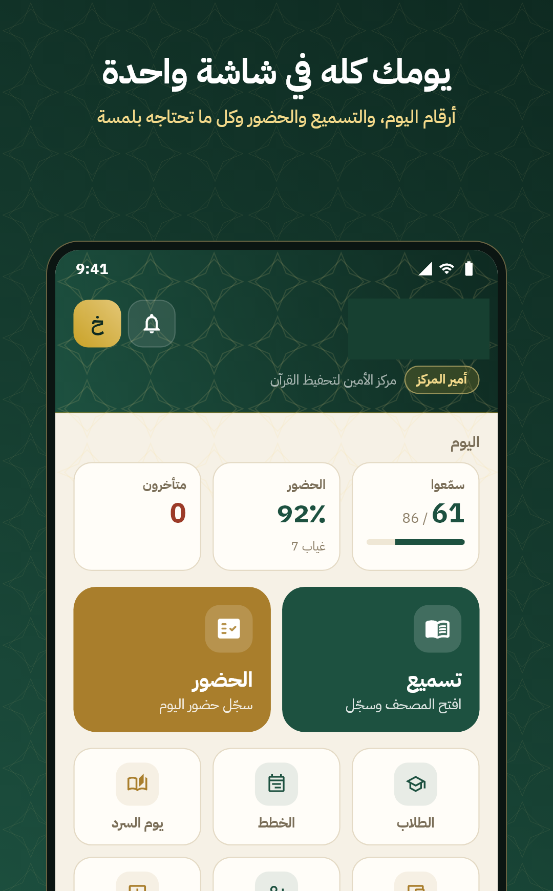
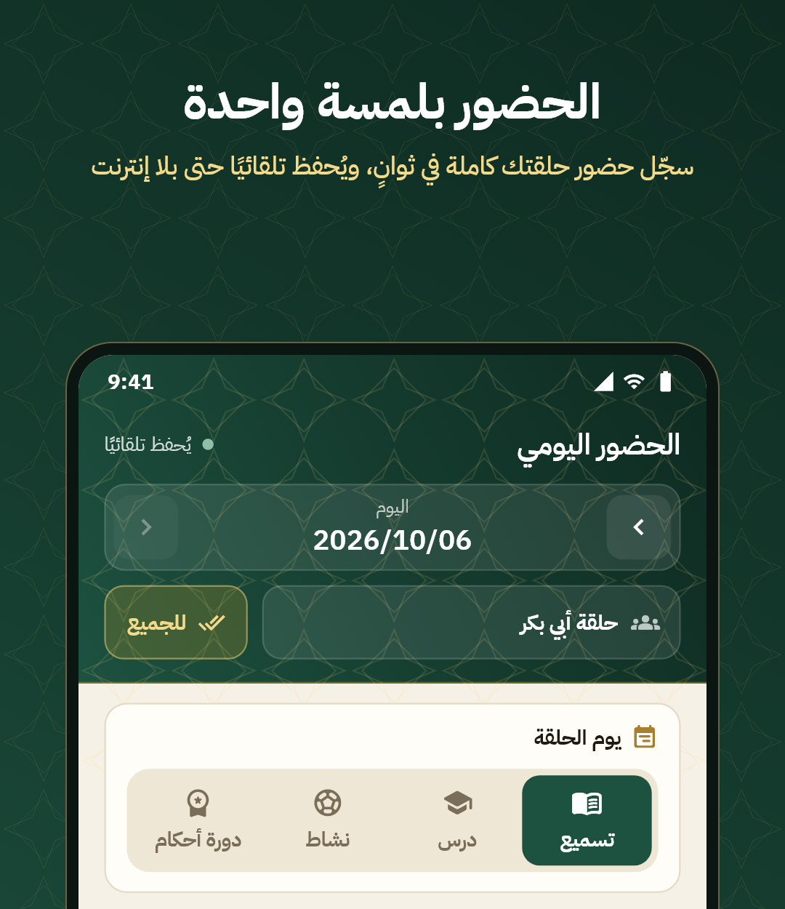
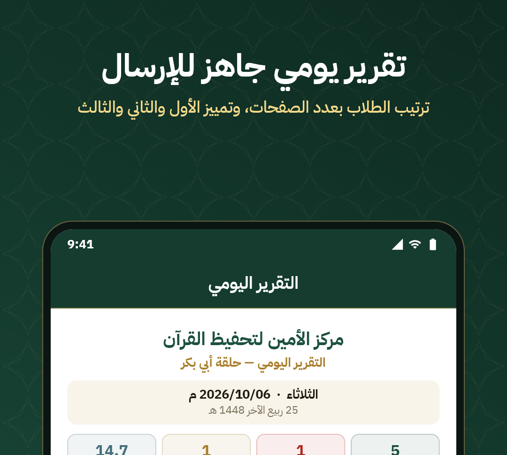
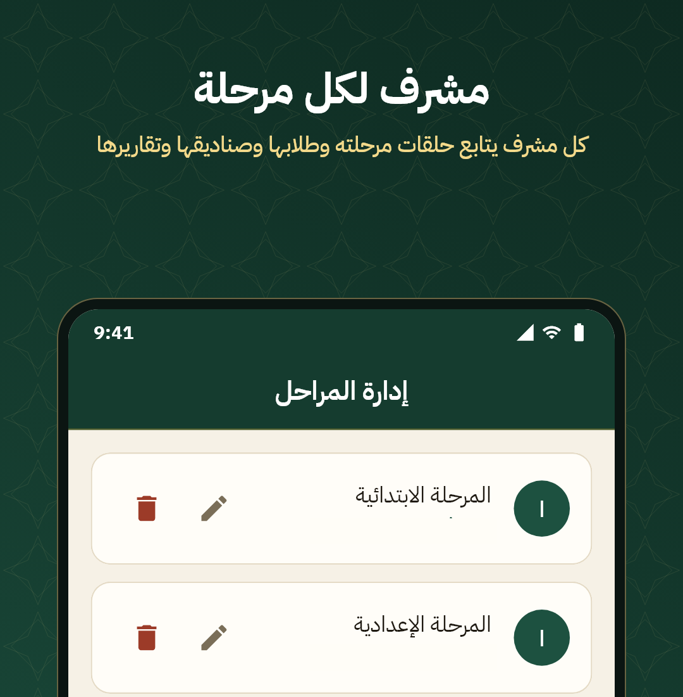

# Al Ameen — Qur'an Memorization & Learning Platform

**An integrated mobile and web solution for organizing Qur'an memorization circles.**

---

## About the Project

Al Ameen helps Qur'an teachers and supervisors manage everyday activities in their memorization circles. The project combines a **Flutter mobile application** with a **Laravel-powered backend**, bringing attendance, memorization follow-up and reporting into a more organized workflow.

My goal was to make routine tasks simpler for educators, while keeping the experience clear and practical on mobile devices.

## App Preview

<table>
  <tr>
    <td align="center" width="50%"></td>
    <td align="center" width="50%"></td>
  </tr>
  <tr>
    <td align="center"><b>Dashboard &amp; daily overview</b></td>
    <td align="center"><b>Attendance management</b></td>
  </tr>
  <tr>
    <td align="center"></td>
    <td align="center"></td>
  </tr>
  <tr>
    <td align="center"><b>Daily reporting</b></td>
    <td align="center"><b>Stages &amp; supervision</b></td>
  </tr>
</table>

> These are real project visuals. Previews have been cropped or redacted to avoid exposing personal details of students and staff.

## Key Features

- **Memorization follow-up:** quick access to daily memorization activities and circle information.
- **Attendance management:** record student attendance with an interface designed for daily use.
- **Offline-friendly attendance:** the supplied application preview describes automatic saving without an internet connection.
- **Daily reports:** review attendance and memorization activity in a structured summary.
- **Educational stages:** organize stages and manage supervision-related workflows.

## Technology & My Role

| Area | Technology / Contribution |
| --- | --- |
| Mobile application | Flutter · Dart |
| Backend | Laravel · PHP |
| Development workflow | Practical use of AI coding assistants when writing and refining Laravel code |
| Focus | Clear interfaces, reusable functionality, and tools that support real classroom workflows |

I developed the mobile app and worked on the backend implementation. I use AI coding tools in my Laravel development workflow; this **does not mean the platform itself contains AI features**.

## Explore the Project

- **Project website:** https://alameen-center.com/
- **GitHub profile:** https://github.com/Ahmedxd1
- **LinkedIn:** https://www.linkedin.com/in/ahmed-al-helou/

## Source Code & Privacy

**This public repository is a portfolio showcase, not the source-code repository.** The application's source code is maintained privately. No application source files, credentials, databases, or personally identifying student records are included in this showcase.

---

Project by Ahmed H. Alhelou · Gaza, Palestine · 2026

